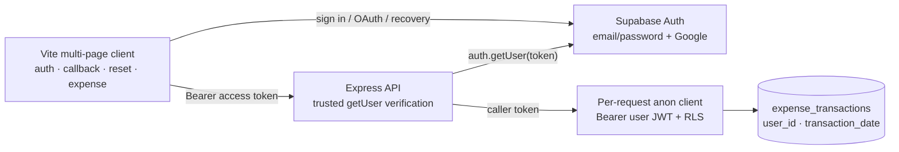

# Authentication implementation checkpoint

**Scope:** local implementation only. No Supabase dashboard change, remote migration, deployment, or credential was performed.

## Architecture



## Delivered work

| Workstream | Files created or modified |
| --- | --- |
| Database | `supabase/migrations/202610230001_expense_transactions_ownership.sql`; `supabase/tests/expense_transactions_security_contract.sql`; `supabase/tests/validate_expense_transactions_migration.ps1` |
| Backend | `server/src/config.js`; `server/src/shared/integrations/supabase.js`; `server/src/shared/middleware/authenticate.js`; `server/src/features/expenses/expenses.{routes,controller,service}.js`; `tests/unit/expenses.test.js`; `tests/unit/middleware.test.js` |
| Frontend | `client/{auth,auth-callback,reset-password}.html`; `client/src/{authPreview,authCallbackPreview,resetPasswordPreview}.jsx`; `client/src/components/auth/*`; `client/src/components/expense/ExpenseSessionGate.jsx`; `client/src/services/supabaseAuth.js`; `client/src/services/expenseApi.js`; `client/src/components/expense/{ExpenseSidebar,ExpenseTrackerApp}.jsx`; `client/vite.config.js`; `client/.env.example`; client package manifests |
| Manager / integration | `.env.example`; `docs/adr/0001-spendwise-authentication-architecture.md`; this report; `tests/integration/expenseAuthRoutes.test.js` |

## API compatibility

`/api/transactions` retains its existing transaction object and response envelope. The server maps the database column `transaction_date` back to the public `date` field, and preserves validation rules. It assigns `user_id` from the verified token rather than accepting it from the request. Missing or non-owned records return `404`; invalid or absent credentials return `401`.

`POST /api/receipts/upload` retains its current draft-only behavior: metadata validation and draft response only. It does not upload receipt bytes or perform AI extraction. It is now protected by authentication.

`/api/admin/*` was not changed or mounted behind the new middleware. It remains a public legacy behavior pending explicit approval; protecting it would be a deliberate breaking change.

## Security review

- Authentication uses Supabase `auth.getUser(accessToken)`, not an unverified JWT decode.
- Authorization reads only verified `app_metadata.role`; absent or unrecognized roles are `user`, and `user_metadata` is ignored.
- Each expense request uses a fresh anon-key Supabase client with the verified caller token, so PostgREST evaluates RLS. The service additionally filters with `user_id = req.user.id`.
- The migration fails if the transaction table is not empty, adds `user_id` with a foreign key, creates the `(user_id, transaction_date desc)` index, and supplies owner-only CRUD policies.
- The migration deliberately does not create a trigger that writes `auth.users`; only a trusted future server-side Admin API workflow may assign `admin`.

## Verification

| Check | Result |
| --- | --- |
| Client production build | Passed: Vite emitted all five MPA entries, including `auth.html`, `auth-callback.html`, `reset-password.html`, and `expense.html`. |
| Focused unit + router-boundary tests | Passed: 25 tests, 0 failures. Covers `401` for unauthenticated transaction and receipt-draft requests, `403` role rejection, and cross-user `404` for get/update/delete. |
| Migration static contract | Passed. No remote database was contacted. |
| JS syntax checks | Passed for modified backend auth/expense code and new integration test. |
| `git diff --check` | Passed (only pre-existing line-ending warnings). |
| Full repository `npm test` | 180 passed, 8 failed. The failures are existing loopback-network integration tests (`tests/integration/apiRoutes.test.js`) that cannot connect in this execution sandbox (`fetch failed` / `EACCES`), not failures in the auth work. |

The router-boundary test avoids that sandbox limitation while running the actual Express expense routes, authentication middleware, validation, controller, service, and error handler together. Remote RLS and Google OAuth were intentionally not claimed as tested.

## Supabase dashboard checklist (before an approved deployment)

1. Apply the reviewed migration through the approved Supabase workflow; first confirm `public.expense_transactions` is empty.
2. Enable Email auth and configure confirmation emails.
3. Enable Google provider and set its Google Cloud client ID/secret in Supabase.
4. Add exact redirect URLs: local `http://localhost:5173/auth-callback.html` and `http://localhost:5173/reset-password.html`, plus the corresponding production HTTPS URLs.
5. Set client `VITE_SUPABASE_URL` and `VITE_SUPABASE_ANON_KEY`; set server `SUPABASE_URL`, `SUPABASE_ANON_KEY`, and any existing server-only secret outside source control.
6. Configure production CORS origins and run an approved real-user RLS test for two accounts.
7. Assign any administrator role only through a controlled, server-side Supabase Admin API process; do not permit client assignment.

## Pending approval items

- Approval to apply the remote SQL migration after reviewing the target database and its empty-table precondition.
- Approval to configure Supabase dashboard providers, redirect URLs, and environment variables.
- Approval to protect legacy `/api/admin/*`, including a compatibility/migration plan for its current callers.
- Approval to deploy and perform real Supabase RLS, email-confirmation, password-recovery, and Google OAuth end-to-end tests.

## Phase 6 local integration attempt (2026-10-23)

### Environment and runtime

Local environment files remain ignored by Git and no credential values were printed or committed. The configured variable names are:

- Client: `VITE_SUPABASE_URL`, `VITE_SUPABASE_ANON_KEY`.
- Server: `SUPABASE_URL`, `SUPABASE_ANON_KEY`, and the existing server-only `SUPABASE_SECRET_KEY` where legacy server functionality requires it.

The client environment contains its two required public variables. The root server environment contains `SUPABASE_URL` and `SUPABASE_SECRET_KEY` but is missing `SUPABASE_ANON_KEY`. That prevents backend Supabase token verification and user-scoped RLS requests; the secret/service key must not be substituted for it.

Commands exercised:

```text
npm --prefix server run dev
npm --prefix client run dev -- --host 127.0.0.1
```

The backend logged startup at `http://localhost:3000`; Vite logged `http://127.0.0.1:5173/` (normally `http://localhost:5173/`). The intended endpoints are `/auth.html`, `/expense.html`, `/auth-callback.html`, `/reset-password.html`, and backend `GET /api/health`.

The server starts, but its vector-store initialization logs a Qdrant fetch failure and `/api/health` is not a dependency-free readiness check because it queries that vector store. This execution sandbox blocks loopback network probes (`EACCES`/timeout), so neither local URL could be browser-verified here despite successful process startup.

### Integration fixes

The authentication flow received focused client-only fixes:

- Explicit PKCE code exchange on callback, with an implicit-token fallback, preventing duplicate URL-code exchange.
- Recovery links establish a recovery session before password update.
- Sign-up redirects correctly when confirmation is disabled and a session is returned.
- Network failures clear loading state and show an error instead of leaving controls disabled.

Modified files: `client/src/services/supabaseAuth.js`, `client/src/components/auth/AuthPage.jsx`, `client/src/components/auth/AuthCallbackPage.jsx`, and `client/src/components/auth/ResetPasswordPage.jsx`.

### Actual test results

| Area | Result |
| --- | --- |
| Client build after Phase 6 fixes | Passed; all five Vite multi-page entries emitted. |
| Auth/expense focused test set | Passed: 25 tests, 0 failures. |
| JWT/RLS static and route-boundary checks | Passed: 401 without credential, 403 for non-admin role, and cross-user get/update/delete 404 coverage. |
| Migration static validation | Passed; no remote schema action was taken. |
| Runtime startup | Backend and Vite both started; direct local probes were blocked by sandbox networking. |
| Email signup/confirmation/sign-in | Not executed against Supabase; requires test identity and browser/email access. |
| Google OAuth | Not executed; requires interactive Google consent. |
| Password reset | Not executed; requires recovery email link and user handoff for final password submission. |
| Real CRUD, persistence, user_id, RLS cross-user checks | Blocked until the root `.env` has `SUPABASE_ANON_KEY` and authorized disposable test users are available. |

### Required manual continuation

1. On this machine, add the same **publishable/anon** key already used by the client to the root `.env` as `SUPABASE_ANON_KEY=...`. Do not use the secret/service key for this value and do not send it in chat.
2. Start the app with `npm start`, then open `http://localhost:5173/auth.html`.
3. Confirm the Supabase redirect allow-list contains the exact local URLs `http://localhost:5173/auth-callback.html` and `http://localhost:5173/reset-password.html`.
4. Use two authorized disposable accounts. Complete email confirmation and Google consent in the browser; report only whether each reaches the application successfully, not any credentials or tokens.
5. After that handoff, real CRUD/RLS testing can safely create and remove only named disposable test transactions.

### Readiness assessment

The local implementation is build-verified and the protected-route/ownership design is test-verified. It is **not ready to claim end-to-end Supabase success**: backend anon-key configuration, interactive provider/email flows, live RLS cross-user checks, and loopback accessibility must be completed first. Legacy `/api/admin/*` remains intentionally unchanged and public pending its separate approval.

### Phase 6 continuation

The missing server `SUPABASE_ANON_KEY` has since been added locally. The server and client Supabase project URLs match, and both `.env` files remain Git-ignored. A server-created Supabase Auth client reached the configured project and rejected an intentionally invalid JWT, confirming the configured key is compatible with the installed SDK for token verification.

`npm start` could not be used because root `concurrently` is not installed in this checkout. The separate existing commands start their respective processes, but this execution environment prevents browser/shell loopback access to those ports. A direct anonymous `expense_transactions` RLS probe also failed at the network layer, so live table/RLS behavior remains unverified. No remote data was read or modified.

Therefore the remaining manual phase is unchanged: use two authorized disposable users from a normal browser/network environment to complete email/OAuth/recovery and CRUD ownership tests. Do not treat the invalid-token check as a replacement for live RLS verification.

### Credential pairing correction

After a browser sign-up attempt returned `Invalid API key`, a local non-secret check decoded only the project-reference claim in the configured legacy JWT-style anon key. Its project reference does **not** match the hostname in `SUPABASE_URL`; the same mismatched anon key is currently present in both root and client environment files. This is the direct cause of the sign-up failure.

Replace the URL and publishable/anon key as a matched pair copied from one Supabase project, then restart both Vite and the server. Never use the server secret/service key in the client or as the anon key.

### Browser UI verification

The local Vite application was opened at `http://localhost:5173/auth.html?mode=signup`. The Sign Up page rendered its branding, display-name/email/password/confirmation fields, Google button, and navigation. Browser checks confirmed client-side invalid email, short-password, and password-mismatch messages; the show/hide password control; and navigation to Sign In. Opening `http://localhost:5173/expense.html` while unauthenticated redirected to `http://localhost:5173/auth.html?next=%2Fexpense.html` as designed. No account was created and no personal credentials were entered during this UI verification.

A repeat browser check confirmed Sign Up validation, Sign In validation, and Forgot Password invalid-email validation. The signed-out state was re-confirmed by navigating to `/expense.html`, which redirected to the Sign In page with `next=%2Fexpense.html`. A real sign-out and reset-email delivery remain untested because there was no valid authenticated test session and no email was submitted.

### OAuth callback repair

The OAuth callback could remain at “Finishing up” because `AuthCallbackPage` referenced `supabase` and `safeNextPath` without importing them. The imports were corrected in `client/src/components/auth/AuthCallbackPage.jsx`. A production build passed, and browser navigation to `http://localhost:5173/auth-callback.html` now executes the callback logic and displays the expected “We could not complete sign-in” state when no authorization code/session is supplied, rather than remaining indefinitely on the loading message. A real provider callback must still be re-tested after correcting the mismatched Supabase URL/key pair.

### Admin authorization implementation

The legacy `/api/admin/*` router is now protected by trusted Supabase authentication and `authorize('admin')`. A missing/invalid JWT receives `401`; a verified non-admin receives `403`. Only verified `app_metadata.role === 'admin'` can reach nested admin routes.

`server/scripts/set-user-role.js` provides an intentional server-only role-management command. It accepts a Supabase user UUID and `admin` or `user`, uses the existing server-only `SUPABASE_SECRET_KEY`, and preserves unrelated `app_metadata`. Example: `npm --prefix server run set-role -- <user-uuid> admin`. It was created but not run, so no account role was changed. The affected user must sign out and sign in again to receive a refreshed JWT.

Focused authentication, ownership, and admin-route tests passed: 26 tests, 0 failures.

### Admin page gate

Vite now emits `admin.html`. Its client-side gate redirects a guest to `/auth.html?next=%2Fadmin.html`, redirects a signed-in non-admin to `/expense.html`, and renders the temporary administrator workspace only when the restored Supabase session has verified `app_metadata.role === 'admin'`. Browser verification confirmed the guest redirect. The backend admin API remains the authoritative enforcement layer.
